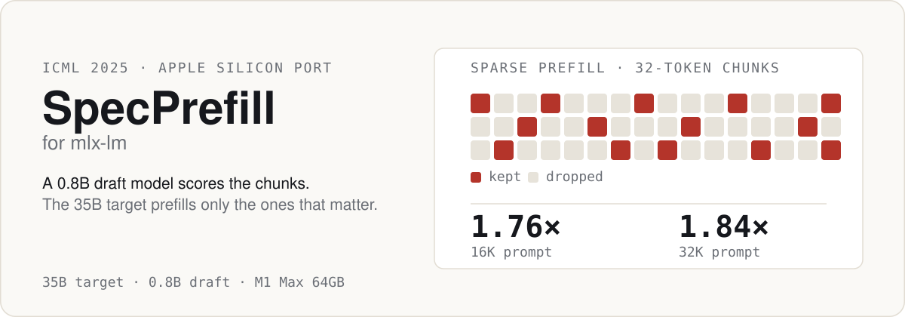

<p align="center">
  
</p>

# SpecPrefill for mlx-lm

**Sparse prefill for long prompts.** A small draft model estimates which tokens matter, and the target model prefills only those — cutting time-to-first-token without touching model weights or training anything.

Ported from [vllm-mlx PR #180](https://github.com/waybarrios/vllm-mlx/pull/180) to [mlx-lm](https://github.com/ml-explore/mlx-lm), for Apple Silicon.

**Paper:** [Speculative Prefill: Turbocharging TTFT with Lightweight and Training-Free Token Importance Estimation](https://arxiv.org/abs/2502.02789) (ICML 2025)

## How it works

1. The prompt is split into fixed 32-token chunks.
2. A small draft model (0.8B) runs a few decode steps and scores each chunk's importance from attention over the lookahead window.
3. The target model prefills only the kept chunks in one sparse pass, with RoPE positions remapped so the surviving tokens keep their original positions.

It triggers only on prompts above `--specprefill-threshold` (default 8192 tokens), so short requests take the normal path.

## Results

**Hardware:** Apple M1 Max 64GB · **Target:** `Qwen3.6-35B-A3B-mixed4_6` · **Draft:** `Qwen3.5-0.8B-MLX-4bit-fp16` · **Date:** 2026-04-21, commit `687cea3`

| Prompt | Baseline pf_tps | SpecPrefill pf_tps | Speedup | Decode tok/s |
|--------|----------------:|-------------------:|---------|--------------|
| 8,192 | 791.9 | 791.3 | 1.00x | 66.4 → 66.6 |
| 16,384 | 734.2 | **1,290.1** | **1.76x** | 61.6 → 29.9 |
| 32,768 | 637.7 | **1,176.2** | **1.84x** | 56.0 → 28.8 |

Source: [`benchmarks/bench_specprefill_official_results.md`](benchmarks/bench_specprefill_official_results.md), raw runs in the adjacent `.json`.

**Read the trade-offs:**

- **No gain at 8,192.** Prompt length equals the threshold, and SpecPrefill only triggers above it.
- **Decode throughput roughly halves** (61.6 → 29.9 tok/s at 16K). The first decode token comes from sparse-prefill logits rather than a full prefill, so this is expected — but it means SpecPrefill pays off when TTFT dominates, not on long generation.
- **Peak memory rises slightly** (~0.3-1.3GB) because the draft model stays loaded.
- **Output quality is not measured here.** These numbers are prefill throughput only. The chunk selection is approximate by design; validate on your workload before relying on it.

`keep_pct` is the main dial. Sweep it on your own hardware with [`benchmarks/bench_keeppct_sweep.py`](benchmarks/bench_keeppct_sweep.py) — results depend on the prompt, so this repo does not ship a universal table.

## Installation

Requires Python 3.10+, `mlx-lm >= 0.31.2`, and a draft model from the same architecture family as your target (Qwen for Qwen).

```bash
pip install mlx-lm
```

### Apply the patches

```bash
# 1. Clone this repo
git clone https://github.com/shivam2014/specprefill-mlx-lm.git
cd specprefill-mlx-lm

# 2. Locate your mlx-lm install and copy the core algorithm
REPO=$(pwd)
MLX_LM=$(python -c "import mlx_lm, os; print(os.path.dirname(mlx_lm.__file__))")
echo "mlx-lm is at: $MLX_LM"
cp "$REPO/patches/specprefill.py" "$MLX_LM/"

# 3. Apply the integration patches
cd "$MLX_LM"
patch -p2 < "$REPO/patches/generate_specprefill.patch"
patch -p2 < "$REPO/patches/cli_generate_specprefill.patch"
patch -p2 < "$REPO/patches/server_specprefill.patch"

# Optional: benchmark.py integration
patch -p2 < "$REPO/patches/benchmark_specprefill.patch"

# 4. Verify nothing is broken
python -m py_compile specprefill.py generate.py server.py benchmark.py
```

If `patch` fails on a version mismatch, use [manual integration](#manual-integration).

### Download a draft model

```bash
huggingface-cli download mlx-community/Qwen3.5-0.8B-MLX-4bit \
    --local-dir ~/.cache/huggingface/hub/Qwen3.5-0.8B-MLX-4bit-fp16
```

### Verify it works

```bash
python -m mlx_lm benchmark \
  --model /path/to/your/Qwen/model \
  --prompt-tokens 16384 \
  --generation-tokens 20 \
  --specprefill-model ~/.cache/huggingface/hub/Qwen3.5-0.8B-MLX-4bit-fp16 \
  --specprefill-keep-pct 0.3
```

If `prompt_tps` comes back higher than the same run without `--specprefill-model`, it is working.

### Manual integration

If `patch` fails (e.g. an mlx-lm version mismatch), integrate by hand:

1. Copy `patches/specprefill.py` into your `mlx_lm/` directory.
2. In `generate.py`, add these kwargs to `generate_step()` and `stream_generate()`:
   ```python
   specprefill_model: Optional[nn.Module] = None,
   specprefill_keep_pct: float = 0.3,
   specprefill_threshold: int = 8192,
   specprefill_lookahead: int = 8,
   specprefill_pool_kernel: int = 13,
   ```
3. In `generate_step()`, replace the normal prefill loop with:
   ```python
   use_specprefill = (
       specprefill_model is not None
       and total_prompt_tokens > specprefill_threshold
       and input_embeddings is None
   )
   if use_specprefill:
       # run score_tokens, select_chunks, sparse_prefill
   else:
       # normal prefill loop
   ```
4. In `server.py`, add the `--specprefill-model` CLI arg and pass it to `stream_generate()`.

Full snippets: [`docs/SPECPREFILL_INTEGRATION.md`](docs/SPECPREFILL_INTEGRATION.md).

## Usage

**Server, with asymmetric KV quantization:**

```bash
python -m mlx_lm server \
  --model ~/.cache/huggingface/hub/Qwen3.6-35B-A3B-mixed4_6 \
  --host 127.0.0.1 --port 8000 \
  --kv-bits 8,4 --kv-group-size 64,32 \
  --prefill-step-size 2048 \
  --specprefill-model ~/.cache/huggingface/hub/Qwen3.5-0.8B-MLX-4bit-fp16 \
  --specprefill-keep-pct 0.3 \
  --specprefill-threshold 8192 \
  --specprefill-lookahead 8 \
  --log-level INFO
```

**Server, minimal:**

```bash
python -m mlx_lm server \
  --model Qwen3.6-35B-A3B-mixed4_6 \
  --specprefill-model Qwen3.5-0.8B-MLX-4bit-fp16 \
  --specprefill-keep-pct 0.3
```

**CLI:**

```bash
python -m mlx_lm generate \
  --model Qwen3.6-35B-A3B-mixed4_6 \
  --prompt "Very long prompt..." \
  --specprefill-model Qwen3.5-0.8B-MLX-4bit-fp16 \
  --specprefill-keep-pct 0.3
```

**Python:**

```python
from mlx_lm import load, stream_generate

model, tokenizer = load("Qwen3.6-35B-A3B-mixed4_6")
draft_model, _ = load("Qwen3.5-0.8B-MLX-4bit-fp16")

for response in stream_generate(
    model, tokenizer,
    prompt="Very long prompt...",
    specprefill_model=draft_model,
    specprefill_keep_pct=0.3,
    specprefill_threshold=8192,
    specprefill_lookahead=8,
):
    print(response.text, end="")
```

**Key flags:** `--kv-bits 8,4` + `--kv-group-size 64,32` enable asymmetric KV split (K=8-bit, V=4-bit); `--specprefill-keep-pct` is the fraction of chunks kept (0.1 for max speedup, 0.3 as a safe default); `--specprefill-threshold` gates the feature to long prompts.

## Hyperparameters

| Parameter | Default | Range | Notes |
|-----------|---------|-------|-------|
| `keep_pct` | 0.3 | 0.1 - 0.5 | Fraction of chunks to keep. 0.1 = max speedup, 0.3 = safe default |
| `threshold` | 8192 | 4096 - 16384 | Minimum prompt length to trigger SpecPrefill |
| `lookahead` | 8 | 4 - 16 | Draft model decode steps used for scoring |
| `pool_kernel` | 13 | 0 (off) - 21 | Smoothing kernel for attention scores |

From the paper: `chunk_size=32` is fixed, and `keep_pct=0.1` is their default for maximum TTFT reduction.

## Reproduce the benchmark

```bash
cd benchmarks

# A/B comparison (baseline vs specprefill)
./run_ab_kv_benchmark.sh

# keep_pct sweep
python bench_keeppct_sweep.py

# Official benchmark module wrapper
python bench_specprefill_official.py \
  --model Qwen3.6-35B-A3B-mixed4_6 \
  --draft-model Qwen3.5-0.8B-MLX-4bit-fp16
```

## Files

```
patches/
  specprefill.py                  # Core algorithm (742 lines)
  generate_specprefill.patch      # generate.py integration
  cli_generate_specprefill.patch  # generate.py CLI args
  server_specprefill.patch        # server.py integration
  benchmark_specprefill.patch     # benchmark.py integration

benchmarks/
  bench_keeppct_sweep.py          # Hyperparameter sweep
  bench_specprefill_official.py   # Official benchmark wrapper
  run_ab_kv_benchmark.sh          # Shell A/B benchmark
  bench_specprefill_official_results.md  # Committed results

docs/
  SPECPREFILL_INTEGRATION.md      # Architecture notes
  PATCH_INVENTORY.md              # Prior patches (thinking models, etc.)
```

## Other patches included

| Patch | File | Status | Description |
|-------|------|--------|-------------|
| **Asymmetric KV split** | `models/cache.py` | **Applied** | `--kv-bits 8,4 --kv-group-size 64,32` for K=8-bit / V=4-bit quantization. Reduces memory vs symmetric KV. |
| PR #1102 memory opt | `convert.py` | Documented | Per-layer eval during quantization (22-37% peak memory reduction). See [`docs/PATCH_INVENTORY.md`](docs/PATCH_INVENTORY.md). |

`preserve_thinking` and `checkpoint_caching` for Qwen3.x thinking models are already present in upstream mlx-lm v0.31.2 (verified against a fresh `pip install mlx-lm==0.31.2`).

## Architecture notes

[`docs/SPECPREFILL_INTEGRATION.md`](docs/SPECPREFILL_INTEGRATION.md) covers:

- RoPE position mapping for surviving tokens
- Hybrid model handling (Qwen3.5 GatedDeltaNet layers)
- How sparse prefill differs from standard speculative decoding

## Credits

- **Paper:** Liu et al., "Speculative Prefill: Turbocharging TTFT with Lightweight and Training-Free Token Importance Estimation", ICML 2025. [arXiv:2502.02789](https://arxiv.org/abs/2502.02789)
- **Reference implementation:** [vllm-mlx PR #180](https://github.com/waybarrios/vllm-mlx/pull/180) by waybarrios
- **Base framework:** [mlx-lm](https://github.com/ml-explore/mlx-lm) by Apple / ml-explore
- **Benchmark methodology:** inspired by [Blaizzy's mlx-vlm TurboQuant benchmark](https://gist.github.com/Blaizzy/d6d975b5a6fde1b590b56f1ca34cdc77)

Community port. Not affiliated with Apple, ml-explore, or the paper authors.

## License

Apache-2.0, matching mlx-lm and the original SpecPrefill paper.
